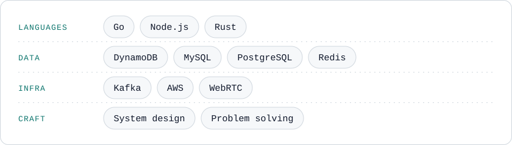
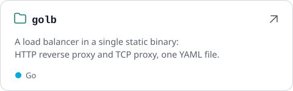
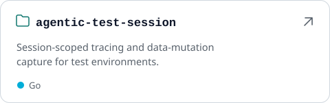

<picture>
  <source media="(prefers-color-scheme: dark)" srcset="assets/hero-dark.svg">
  
</picture>

  <a href="https://leetcode.com/mappiecoder/">LeetCode</a>
  &nbsp;·&nbsp;
  <a href="http://www.swapcode.in">Blog</a>
  &nbsp;·&nbsp;
  <a href="https://github.com/maheshpaliwal?tab=repositories">All repositories</a>

 

#### Now

- Building [**golb**](https://github.com/maheshpaliwal/golb), a load balancer in Go.
- Building [**agentic-test-session**](https://github.com/maheshpaliwal/agentic-test-session) (tsession): start a session, exercise your Go services, stop it, and see what ran, in what order across services, and what data each write changed. Made for test environments.
- Working with WebRTC, and open to collaborating on it.
- Learning Rust.
- Ask me about Go and Node.js.

#### Skills

<picture>
  <source media="(prefers-color-scheme: dark)" srcset="assets/skills-dark.svg">
  
</picture>

#### Building

  <a href="https://github.com/maheshpaliwal/golb">
    <picture>
      <source media="(prefers-color-scheme: dark)" srcset="assets/card-golb-dark.svg">
      
    </picture>
  </a>
  <a href="https://github.com/maheshpaliwal/agentic-test-session">
    <picture>
      <source media="(prefers-color-scheme: dark)" srcset="assets/card-tsession-dark.svg">
      
    </picture>
  </a>

